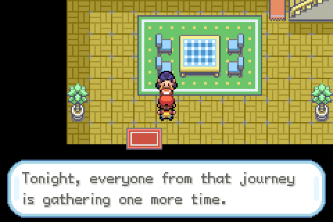
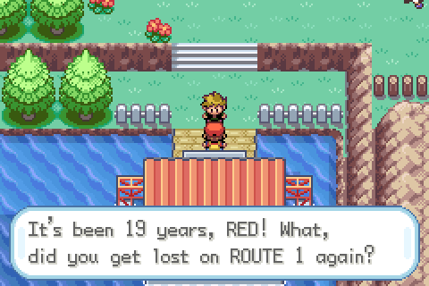

# Pokémon FireRed: Rematch

*A fan-made, one-evening reunion for everyone who once left Pallet Town with a map and a dream.*

> A letter arrives with no name on it.
> *"Tonight, everyone from that journey is gathering one more time."*

<p align="center">
  
  
  <br>
  
  
</p>

Years later, you take the ferry back. The Gym Leaders are scattered around a garden by the sea, still
themselves, just a little older. Your rival is waiting on the steps, pretending it's the sea breeze in his
eyes. And the Elite Four have one last rematch planned, but this time he fights beside you.

It takes an hour or two. There is no saving: like the night itself, it happens once.

## Speedrun demo (YouTube)

<p align="center">
  <a href="https://www.youtube.com/watch?v=oXuqrqkp6zY">
    
  </a>
  <br>
  <em>A full run, start to finish (click to watch on YouTube). It's a speedrun, so it only stops for a few of
  the main characters; most of the island's little touches are left for you to find.</em>
</p>

## Build it

You don't need an original ROM. Everything builds from source, thanks to the
[pret/pokefirered](https://github.com/pret/pokefirered) decompilation this project is based on.

1. Install [Docker](https://www.docker.com/).
2. From the repository root, run:
   ```sh
   tools/rom-builder/make.sh
   ```
   The first run builds the toolchain image (agbcc, Poryscript), which takes a few minutes.
3. Open `game/pokefirered.gba` in an emulator such as [mGBA](https://mgba.io/downloads.html).
   On a recent macOS, if you hear sound but see a black screen, set
   **Settings → Display → Display driver** to **Software**.

To make it someone's own night, change the names and years in `game/src/rematch_block.c`
(by default: RED, his rival BLUE, born 1993, played in 2007) and build again.

## Play it in a browser (optional)

`web/` is a small page that asks a friend a few questions (their old trainer and rival names, the year they
played), writes the answers into the ROM in memory, and runs it with a self-hosted
[EmulatorJS](https://emulatorjs.org/), on phones too. Nothing is saved: closing the tab ends the night.

- **Locally:** build the ROM, then run `sh web/sync-rom.sh`, `tools/fetch-web-vendor.sh` and
  `python3 tools/serve-web.py 8080`, and open http://localhost:8080. Make yourself an invite code with
  `python3 tools/invite.py add "Your name"`.
- **On AWS, for your own circle only:** `infra/` is a CDK stack that keeps the ROM in a private bucket behind
  invite codes. Never host it publicly. See [infra/README.md](infra/README.md).

## What's inside

| Path | What it is |
|---|---|
| `game/` | The fork of pret/pokefirered. Our maps are `data/maps/Rematch*`, our C code `src/rematch*.c`, our map and sprite generators `tools/rematch/` |
| `tools/rom-builder/` | The Docker toolchain behind `make.sh` |
| `web/` | The browser page: questions, encoder, emulator, closing page |
| `infra/` | The AWS CDK stack (private, invite-only hosting) |
| `tools/` | `serve-web.py` (local server), `invite.py`, `read-messages.py`, `deploy.sh`, `cdk.sh` |
| `docs/dialogue.md` | The whole script of the night, every line |

## Fan-made, with love

This is an unofficial, non-commercial fan project. It is not affiliated with, endorsed by, or connected to
Nintendo, Game Freak, Creatures Inc. or The Pokémon Company. Pokémon and all related names are trademarks of
their respective owners. No ROM is distributed here: you build your own from source. Please support the
official games.

Built on the work of [pret](https://github.com/pret), [agbcc](https://github.com/pret/agbcc) and
[Poryscript](https://github.com/huderlem/poryscript).

*Thank you for playing, one more time.*
